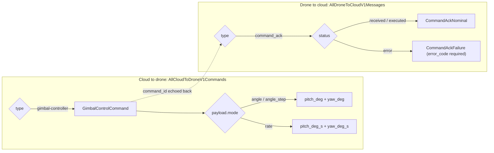

# Drone message contracts

A small shared Pydantic library for cloud-to-drone gimbal commands and drone-to-cloud command acknowledgements. It validates message shape, serializes models to wire JSON and publishes the same contract as JSON Schema for non-Python consumers. It does not connect to a drone, execute a command, or prove that a physical action is safe.

The package name is `drones_comms_model`. Its scope is narrower than a general telemetry platform: one command family and its acknowledgement variants.

## How messages are routed

Both directions are discriminated unions keyed on the JSON `type` field. Acknowledgements then pick a nominal or failure variant by `status`.



## Usage

```python
from pydantic import TypeAdapter
from drones_comms_model import AllCloudToDroneV1Commands

commands = TypeAdapter(AllCloudToDroneV1Commands)
command = commands.validate_json(
    '{"type": "gimbal-controller", "timestamp": "2025-06-01T14:00:00+02:00",'
    ' "payload": {"mode": "angle", "pitch_deg": -30, "yaw_deg": 90, "duration_s": 1.5}}'
)
print(commands.dump_json(command, indent=2).decode())
```

Output from a run (the generated UUID is shortened here):

```json
{
  "command_id": "<uuid4>",
  "timestamp": "2025-06-01T12:00:00Z",
  "type": "gimbal-controller",
  "payload": {
    "mode": "angle",
    "pitch_deg": -30.0,
    "yaw_deg": 90.0,
    "pitch_deg_s": null,
    "yaw_deg_s": null,
    "duration_s": 1.5,
    "relative": null
  }
}
```

The `+02:00` input was normalised to UTC, and the wire names (`type`, `timestamp`) are used without passing `by_alias=True`. Every command gets a fresh `command_id` unless the sender supplies one; the drone echoes it in its acknowledgement.

Acknowledgements go through the second union:

```python
from drones_comms_model import AllDroneToCloudV1Messages

messages = TypeAdapter(AllDroneToCloudV1Messages)
ack = messages.validate_python(
    {
        "type": "command_ack",
        "command_id": "11111111-1111-4111-8111-111111111111",
        "timestamp": "2025-06-01T12:00:01Z",
        "status": "error",
        "error_code": "HARDWARE_FAILURE",
        "message": "gimbal motor stalled",
    }
)
print(type(ack).__name__, ack.status, ack.error_code)
print(messages.dump_json(ack).decode())
```

```text
CommandAckFailure error HARDWARE_FAILURE
{"message_id":"<uuid4>","timestamp":"2025-06-01T12:00:01Z","version":"1.0","type":"command_ack","command_id":"11111111-1111-4111-8111-111111111111","status":"error","error_code":"HARDWARE_FAILURE","message":"gimbal motor stalled"}
```

## What is validated

| Field | Rule |
| --- | --- |
| `type` | Required by both unions. Unknown values fail with `union_tag_invalid`. |
| `timestamp` | Optional (defaults to now, UTC). Must carry an offset; naive values are rejected and aware ones converted to UTC. |
| `command_id` | UUID. Commands generate one by default; acknowledgements require it. |
| `payload.mode` | `angle`, `angle_step` or `rate`. |
| `pitch_deg`, `yaw_deg` | Required in the angle modes, rejected in `rate` mode. |
| `pitch_deg_s`, `yaw_deg_s` | Required in `rate` mode, rejected in the angle modes. |
| All numbers | Finite only (NaN and infinity are rejected). Integers are accepted; numeric strings and booleans are not. |
| `duration_s` | Optional, strictly positive. |
| `relative` | Optional, a real boolean (`"true"` and `1` are rejected). |
| `status`, `error_code` | Enumerated. An `error` status requires `error_code`; `message` is optional. |
| `version` | Acknowledgements only accept `"1.0"`. |

Some failures from a run:

```text
gimbal-controller.payload
  Value error, pitch_deg_s and yaw_deg_s are required for 'rate' mode [type=value_error, input_value={'mode': 'rate', 'pitch_deg_s': 1}, input_type=dict]

gimbal-controller.timestamp
  Input should have timezone info [type=timezone_aware, input_value='2025-06-01T12:00:00', input_type=str]

gimbal-controller.payload.pitch_deg
  Input should be a finite number [type=finite_number, input_value=nan, input_type=float]
```

### Design choices

- **Unknown keys are forbidden on commands and ignored on acknowledgements.** A misspelled command field (`pitch` for `pitch_deg`) must fail loudly instead of being dropped on the way to the aircraft. In the other direction, the cloud should keep accepting acknowledgements from firmware that adds fields before the schema catches up.
- **No angle or rate limits.** Travel and speed limits depend on the gimbal hardware, so the models do not guess them. Consumers that need limits should enforce them on top of these contracts. These models are not a safety interlock.
- **Non-finite numbers are rejected** because JSON has no NaN; Pydantic would emit `null`, and the message would then fail its own validation on the receiving side.
- Python field names (`timestamp_utc`, `command_type_c2d`, `error_message`) are accepted on input alongside the wire names, which keeps construction in Python code readable.

## JSON Schema

`schemas/` holds one draft 2020-12 document per direction, generated from the models:

- `schemas/c2d-commands.v1.schema.json`: cloud-to-drone commands
- `schemas/d2c-messages.v1.schema.json`: drone-to-cloud messages

They use the OpenAPI `discriminator` keyword for routing hints, and also list `type` as required so plain JSON Schema validators reach the same verdict as the models (a test runs `jsonschema` against both files). The schemas cannot express one rule: the mode-dependent pairing of angle and rate fields. That check lives only in the Pydantic models.

After changing a model, regenerate the files. The snapshot test fails until they match:

```sh
poetry run python scripts/export_schemas.py          # write schemas/
poetry run python scripts/export_schemas.py --check  # exit 1 if any file is stale
```

## Setup and checks

Requirements: Python 3.12 or 3.13 (`.python-version` pins 3.13) and Poetry 2.5.1 or newer. The only runtime dependency is Pydantic 2.14.

```sh
pip install "poetry==2.5.1"
poetry install
poetry run pytest
poetry run ruff check . && poetry run ruff format --check .
poetry run mypy
```

The suite has 128 tests: per-field boundary cases for both directions, routing at both union levels, Hypothesis property tests that round-trip generated commands and acknowledgements through JSON, and the schema snapshot and validator checks. mypy runs in strict mode with the Pydantic plugin over the package, scripts and tests.

These are software contract tests only. No drone, telemetry transport or hardware was involved.

## License

MIT, see [LICENSE](LICENSE).
